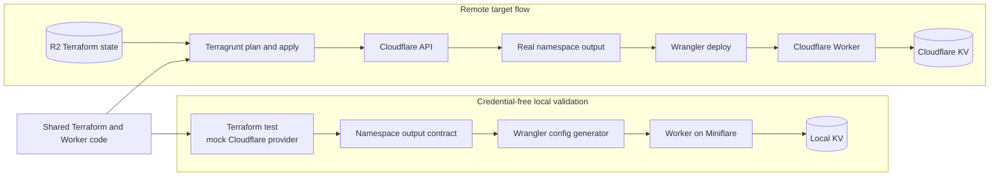

# EdgeFlags

EdgeFlags is a lightweight feature flag service built as a learning playground for
Cloudflare Workers, infrastructure as code, delivery automation, security,
observability, and site reliability engineering.

> [!IMPORTANT]
> EdgeFlags is not intended to be a production-ready feature flag platform. The
> feature flag domain is deliberately small so the project can focus on the
> engineering practices around it.

## Current status

Phases 1 through 6 and Phase 8 API security are complete, while development
delivery from Phase 7 is operational and production delivery remains pending.
The repository
contains a reproducible development toolchain, a local and remotely validated
KV-backed Worker, Terragrunt composition for distinct `dev` and `prod`
infrastructure, credential-free pull request validation, environment-scoped
remote plans, and automatic development deployment with remote smoke tests.

The remaining infrastructure and broader architecture described in the
documentation are target outcomes. They will become available incrementally as
the roadmap is implemented.

## Purpose

EdgeFlags provides a self-contained environment for learning and experimenting
with:

- TypeScript and Cloudflare Workers
- Cloudflare KV and eventual consistency
- OpenFeature and OFREP interoperability
- Terraform and Terragrunt
- GitHub Actions and deployment automation
- API authentication, authorization, and abuse protection
- Logs, metrics, traces, SLIs, SLOs, and alerts
- Load testing and controlled failure injection
- Security and dependency scanning
- Architecture Decision Records

The goal is not to maximize the number of tools. Every capability should support
a concrete learning objective, experiment, or operational outcome.

## Principles

### Free-tier first

Default local and deployed environments should use free tiers whenever possible.
A capability that requires a paid service must have a free alternative, remain
optional, or be documented without being enabled by default.

### Reproducible by default

Tool versions, development commands, infrastructure, tests, and experiments
should live in the repository. A new clone should not depend on undocumented
machine-level setup.

### Observable outcomes

A phase is complete only when its result can be demonstrated or measured. Adding
configuration files without validating their behavior is not enough.

### Decisions with context

Significant choices should record their constraints, alternatives, trade-offs,
and validation method in an Architecture Decision Record.

## Architecture and validation path



Local checks exercise the Terraform output contract, the same configuration
generator used for deployment, the Worker HTTP lifecycle, and an isolated local
KV implementation. They never contact Cloudflare. The remote development path
is automated with R2 state backup, exact-plan apply, Worker deployment, Access
authentication, and a post-deployment smoke test.
The initial product scope is intentionally small: create, read, delete, and
evaluate boolean feature flags. Later phases add security, deterministic
rollouts, targeting, interoperability, and operational experiments.

See [Architecture](docs/ARCHITECTURE.md) for component responsibilities,
interfaces, constraints, and planned evolution.

## Documentation

- [Architecture](docs/ARCHITECTURE.md): target system design and boundaries
- [API](docs/API.md): implemented HTTP operations, responses, and errors
- [Development](docs/DEVELOPMENT.md): target local workflow, tools, and tests
- [Delivery](docs/DELIVERY.md): branches, environments, CI, and deployments
- [Infrastructure](docs/INFRASTRUCTURE.md): environment composition, state, and free-tier inventory
- [Roadmap](docs/ROADMAP.md): canonical implementation order and outcomes
- [Experiments](docs/EXPERIMENTS.md): planned experiments and result template
- [Architecture decisions](docs/adr/README.md): ADR policy and records

## Roadmap

Implementation is organized into 17 incremental phases, beginning with the
project bootstrap and ending with hardening, documentation, and a retrospective.
Each phase has explicit deliverables, dependencies, exclusions, and completion
criteria.

The canonical roadmap is [docs/ROADMAP.md](docs/ROADMAP.md). GitHub milestones
will represent phases, while issues will represent reviewable units of work.

## Developer workflow

Install the pinned toolchain and application dependencies from a clean clone:

```bash
mise install
make install
```

The shared task interface is:

```bash
make help
make dev
make architecture
make format
make format-check
make lint
make typecheck
make test
make worker-infra-test
make security
make infra-check
make infra-plan ENV=dev
make infra-plan ENV=prod
make access-token-create ENV=dev
make access-token-rotate ENV=dev
make access-validate ENV=dev BASE_URL=https://...
make pre-commit
make check
```

Infrastructure tasks select `dev` by default and accept `ENV=dev|prod` where
documented. `make security` scans dependencies, committed content, and
infrastructure configuration. Load-testing tasks will be added through the same
interface in their corresponding phase. Make delegates tool execution to the
versions managed by mise.

Installing dependencies also configures the Husky pre-commit hook. The hook runs
the fast `make pre-commit` checks and can be invoked directly when needed. It is
a local feedback mechanism; repository validation must not rely on a hook that
Git allows contributors to skip.

## Branches and releases

- Development branches merge into `develop` through pull requests.
- `develop` is the integration branch for ongoing work.
- `main` contains the stable state of the project.
- Promoting `develop` to `main` represents a production release and will trigger
  production deployment once continuous delivery is implemented.

See [Delivery](docs/DELIVERY.md) for the complete target workflow.

## Non-goals

EdgeFlags is not intended to:

- compete with established feature flag platforms,
- provide production-grade multi-tenancy or availability guarantees,
- support large-scale production traffic,
- provide a polished administration interface,
- act as a production identity platform, or
- introduce infrastructure solely to make the design look more complex.

## License

See [LICENSE](LICENSE).
