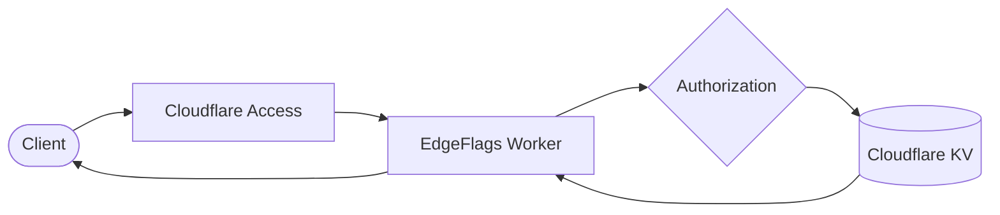
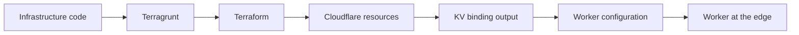

# EdgeFlags

**A tiny feature flag service with a surprisingly complete journey to the edge.**

[](https://github.com/jfrz38/edgeflags/actions/workflows/pull-request.yml)


> [!IMPORTANT]
> EdgeFlags is a personal learning project and an experimental playground. It is
> not a production-ready or professionally supported feature flag service. Do not
> rely on it for real production systems, sensitive data, or critical releases.

EdgeFlags is a small feature flag service built on Cloudflare Workers and KV.
It follows a boolean decision through a complete edge-native system: an
authenticated API, distributed storage, infrastructure as code, automated
validation, and controlled delivery.

The feature flag domain stays intentionally compact so the engineering around
it remains easy to see, understand, and experiment with.

## One flag, all the way to the edge

A client asks EdgeFlags whether a feature is enabled. Cloudflare Access verifies
who is making the request, the Worker checks what that identity is allowed to
do, and the flag value is retrieved from Cloudflare KV close to where the
request is served.



Authentication and authorization are separate on purpose: Cloudflare Access
establishes the client's identity, while EdgeFlags grants that identity only the
operations it needs.

## A small API with clear behavior

Create a flag such as `new-checkout`, switch it on or off, inspect its
definition, or ask EdgeFlags for its effective value.

```http
PUT /flags/new-checkout
Content-Type: application/json

{"enabled":true}
```

```http
GET /evaluate/new-checkout

{"key":"new-checkout","value":true}
```

The API keeps a missing flag distinct from a disabled flag. Writes and deletes
are safe to retry, validation errors have stable responses, and storage details
do not leak into the public contract.

## The cloud setup is part of the project

EdgeFlags does not treat infrastructure as a collection of manual dashboard
steps. Terraform describes the Cloudflare resources, Terragrunt composes the
environment configuration, and R2 stores the infrastructure state.

Real infrastructure outputs connect each Worker deployment to its KV namespace,
so the path from an empty environment to a working service is reviewable and
reproducible.



Automated checks exercise the same contracts without requiring access to a real
Cloudflare account. Local infrastructure tests use a mocked provider, while the
Worker runs against an isolated KV implementation through Miniflare.

## Built to be explored

EdgeFlags brings several engineering concerns together in one approachable
codebase:

- domain and application logic that do not depend on Cloudflare APIs;
- a KV adapter that keeps distributed storage behind a clear boundary;
- identity verification and scope-based authorization;
- reproducible cloud infrastructure and isolated state;
- local integration tests that never call real services; and
- delivery workflows with validation, state backup, deployment, and smoke tests.

The result is deliberately more than a CRUD example, yet small enough to trace
a request from its HTTP entry point to the edge storage layer.

## Scope

EdgeFlags is an engineering playground, not a production-ready replacement for
an established feature flag platform. It favors observable experiments and
explicit trade-offs over a large feature set.

Cloudflare KV is eventually consistent, automated client credentials are meant
for trusted server-side consumers, and the project makes no high-availability or
large-scale traffic guarantees.

## Explore the project

- [Architecture](docs/ARCHITECTURE.md) — components, boundaries, and design constraints
- [API](docs/API.md) — operations, authentication, responses, and errors
- [Infrastructure](docs/INFRASTRUCTURE.md) — Terraform, Terragrunt, R2 state, and Cloudflare resources
- [Delivery](docs/DELIVERY.md) — validation, deployment, recovery, and credentials
- [Experiments](docs/EXPERIMENTS.md) — hypotheses, procedures, evidence, and conclusions
- [Architecture decisions](docs/adr/README.md) — important choices and their trade-offs
- [Roadmap](docs/ROADMAP.md) — learning outcomes and future experiments

## License

See [LICENSE](LICENSE).
